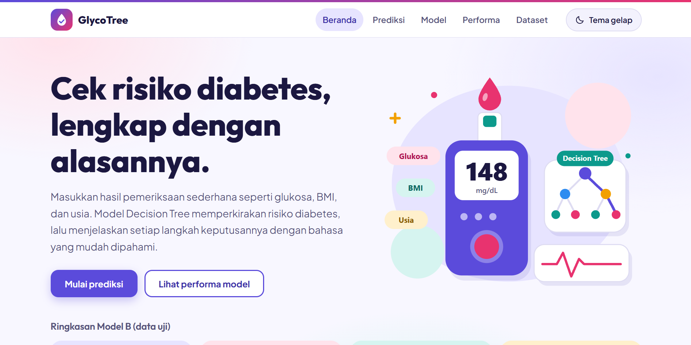
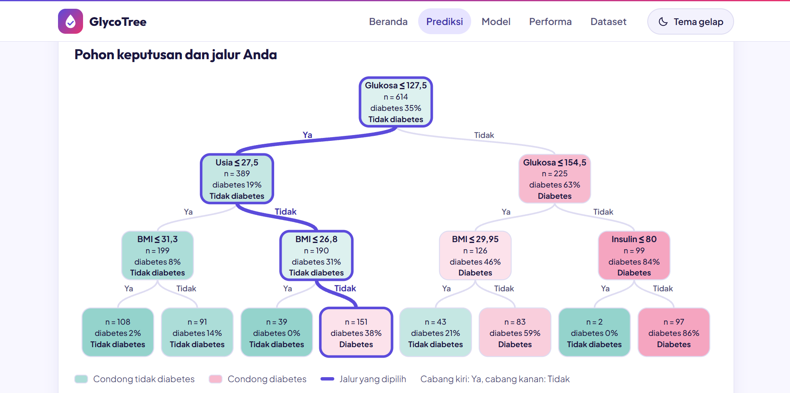
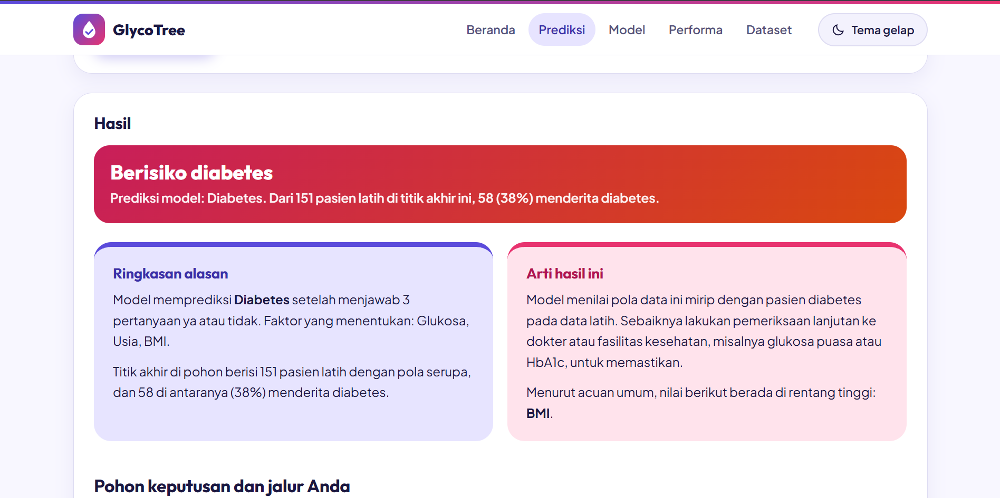
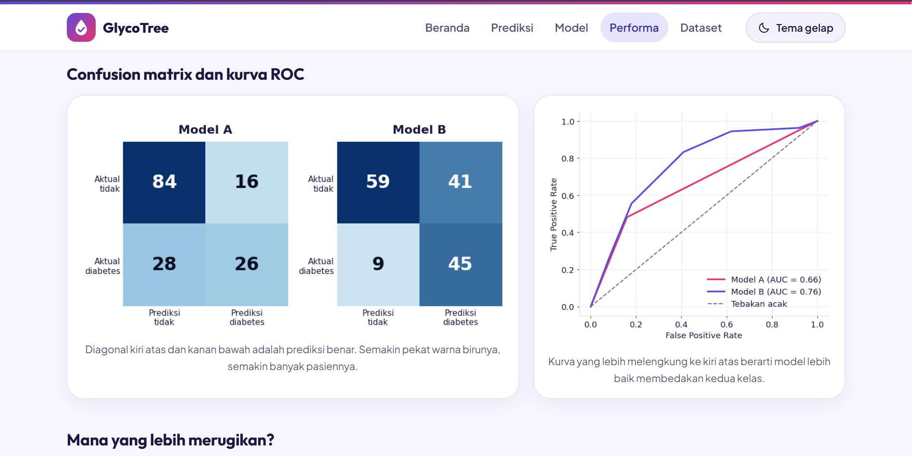

# GlycoTree - Klasifikasi Risiko Diabetes dengan Decision Tree


Aplikasi web Flask untuk **klasifikasi** pasien menjadi **diabetes** atau **tidak diabetes** menggunakan algoritma **Decision Tree** (`DecisionTreeClassifier`). Selain label prediksi, aplikasi menjelaskan hasilnya: ringkasan alasan, arti hasil, **pohon keputusan** dengan jalur pasien berwarna, perbandingan nilai dengan acuan umum, dan tingkat keandalan model. Proyek ini adalah Tugas Akhir 5 (TA-05) mata kuliah Pembelajaran Mesin.

---

## Halaman Aplikasi

| Halaman | Isi |
|---|---|
| **Beranda** | Pengenalan diabetes, delapan indikator beserta pengaruhnya, cara kerja, keandalan dan batasan model |
| **Prediksi** | Formulir pasien, label prediksi, penjelasan hasil, pohon dengan jalur berwarna, alasan langkah demi langkah, dan tabel nilai dibanding acuan |
| **Model** | Pohon Model B, tiga aturan jika-maka, dan feature importance |
| **Performa** | Perbandingan Model A dan B, confusion matrix, kurva ROC, dan pemilihan kedalaman pohon |
| **Dataset** | Daftar fitur, sebaran kelas, korelasi, sebaran fitur, dan data yang hilang |

Fitur lain: tema **terang dan gelap** (setiap kunjungan baru selalu mulai terang), validasi input, kolom opsional yang diisi median data latih, serta tampilan responsif untuk desktop dan ponsel.

---

## Teknologi

| Komponen | Teknologi |
|---|---|
| Backend | Flask 3, Gunicorn |
| Machine Learning | scikit-learn (DecisionTreeClassifier, SimpleImputer, Pipeline) |
| Data Processing | Pandas, NumPy |
| Visualisasi | Pohon digambar sebagai SVG oleh Flask, grafik lain dengan Matplotlib, Seaborn di notebook |
| Penyimpanan Model | Joblib |
| Frontend | HTML (Jinja2), CSS, JavaScript |

---

## Dataset

- **Sumber:** [Kaggle - Pima Indians Diabetes (CSV)](https://www.kaggle.com/datasets/kumargh/pimaindiansdiabetescsv)
- **Jumlah data:** 768 baris (614 latih, 154 uji)
- **Fitur (8):** Pregnancies, Glucose, BloodPressure, SkinThickness, Insulin, BMI, DiabetesPedigreeFunction, Age
- **Target:** Outcome (1 = diabetes, 0 = tidak)
- **Proporsi kelas:** 34,9% diabetes, 65,1% tidak
- **Berkas tanpa header:** nama kolom diberikan saat membaca CSV (`header=None, names=...`)
- **Data hilang:** tidak ada sel kosong, tetapi angka 0 pada Glucose (5), BloodPressure (35), SkinThickness (227), Insulin (374), dan BMI (11) mustahil secara medis. Angka 0 itu dianggap hilang lalu diisi median data latih.
- **Fitur kategorikal:** tidak ada, semua fitur sudah numerik, jadi tidak ada langkah encoding.

---

## Performa Model

Evaluasi pada 154 data uji (pembagian 80:20 berstrata). Kedua model memakai `class_weight="balanced"`, satu-satunya perbedaan adalah `max_depth`.

| Metrik | Model A (`max_depth=None`) | Model B (`max_depth=3`) |
|---|---|---|
| Kedalaman / jumlah daun | 15 / 119 | 3 / 8 |
| Akurasi data latih | 100,0% | 73,1% |
| Akurasi data uji | 71,4% | 67,5% |
| Akurasi validasi silang (5 lipatan) | 67,3% | 69,7% |
| AUC data uji | 0,66 | **0,76** |
| AUC validasi silang | 0,64 | **0,80** |
| **Recall diabetes (data uji)** | 48% | **83%** |
| Precision diabetes (data uji) | 62% | 52% |

Angka validasi silang Model A bisa berbeda sekitar satu poin antar versi scikit-learn, karena pohon yang tumbuh penuh sensitif terhadap urutan pemilihan fitur. Model B stabil di semua versi.

**Cara membaca hasil:**

- Model A menghafal data latih (akurasi 100%, selisih dengan data uji 29 poin). Model B selisihnya hanya 6 poin.
- Akurasi uji Model A justru sedikit lebih tinggi daripada Model B. Selisih ini hanya sekitar 6 pasien dari 154 dan tidak menunjukkan model yang lebih baik: Model B unggul pada AUC, recall, dan validasi silang.
- Pada skrining, melewatkan pasien diabetes lebih merugikan daripada salah menandai pasien sehat. Model B hanya melewatkan 9 pasien diabetes (Model A: 28), dengan harga lebih banyak pasien sehat yang ikut ditandai (41 dibanding 16).
- `max_depth=3` dipilih karena AUC validasi silangnya tertinggi dan pohonnya hanya 8 daun sehingga mudah dibaca.

> **Catatan:** model ini alat bantu belajar, bukan alat diagnosis. Data hanya mencakup wanita suku Pima berusia 21 tahun ke atas, dengan 768 baris.

---

## Aturan Jika-Maka (Model B)

1. Jika glukosa ≤ 127,5 dan usia ≤ 27,5 dan BMI ≤ 31,3, maka **tidak diabetes** (2 dari 108 pasien latih diabetes).
2. Jika glukosa > 127,5 dan glukosa > 154,5 dan insulin > 80, maka **diabetes** (83 dari 97 pasien latih diabetes).
3. Jika glukosa ≤ 127,5 dan usia > 27,5 dan BMI > 26,8, maka **diabetes** (58 dari 151 pasien latih, ambang risiko sekitar 35% karena `class_weight="balanced"`).

Feature importance: Glukosa 61%, BMI 22%, Usia 15%, Insulin 2%. Fitur lainnya tidak dipakai pohon sedalam tiga tingkat.

---

## Instalasi Lokal

### 1. Clone repository

```bash
git clone https://github.com/Alnazh/ta05-diabetes-decision-tree.git
cd ta05-diabetes-decision-tree
```

### 2. Buat virtual environment

```bash
python -m venv venv

# Windows (PowerShell, jika muncul error execution policy:
# Set-ExecutionPolicy -Scope Process Bypass)
venv\Scripts\activate

# Linux / macOS
source venv/bin/activate
```

### 3. Install dependencies

```bash
pip install -r requirements.txt
```

### 4. Jalankan aplikasi

```bash
python app.py
```

Buka browser di `http://127.0.0.1:5000`. Model sudah tersedia di folder `model/`, jadi **tidak perlu melatih model lebih dulu**.

Jika versi scikit-learn di komputer Anda berbeda dari versi yang dipakai saat model disimpan, aplikasi otomatis melatih ulang model saat pertama dijalankan (beberapa detik). Setelah itu aplikasi langsung siap dipakai.

---

## Struktur Project

```
ta05-diabetes-decision-tree/
├── app.py                                # Aplikasi Flask: rute, validasi, prediksi, jalur keputusan
├── config.py                             # Jalur berkas, nama kolom, label, palet grafik
├── train_model.py                        # Pelatihan Model A dan B, metrik, aturan jika-maka
├── figures.py                            # Grafik Matplotlib (versi terang dan gelap)
├── tree_view.py                          # Tata letak pohon keputusan untuk digambar sebagai SVG
├── analisis_diabetes_decision_tree.ipynb # Notebook EDA, evaluasi, interpretasi
├── Procfile                              # Perintah Gunicorn
├── requirements.txt                      # Daftar dependensi Python
├── .gitignore
│
├── data/
│   └── pima-indians-diabetes.csv         # Dataset 768 baris (tanpa header)
│
├── model/
│   ├── model.joblib                      # Pipeline Model B tersimpan
│   └── metrics.json                      # Metrik, aturan, statistik simpul
│
├── templates/
│   ├── base.html                         # Kerangka: header, menu, footer
│   ├── macros.html                       # Komponen bersama: pohon SVG, spanduk hasil, langkah, kepala halaman
│   ├── index.html                        # Beranda
│   ├── predict.html                      # Prediksi
│   ├── model.html                        # Model
│   ├── performance.html                  # Performa
│   └── dataset.html                      # Dataset
│
├── static/
│   ├── style.css                         # Gaya, termasuk token tema terang dan gelap
│   ├── theme-init.js                     # Memastikan tema awal terang; gelap hanya bertahan selama sesi
│   ├── art/                              # Ilustrasi beranda (SVG terang dan gelap)
│   ├── app.js                            # Tombol tema, menu mobile, contoh isian, penanda ambang
│   └── img/                              # Grafik hasil pelatihan (terang dan gelap)
│
└── docs/
    └── screenshots/                      # Tangkapan layar aplikasi
```

---

## Training Ulang Model

```bash
python train_model.py
```

Script membersihkan data, membagi data 80:20, melatih Model A dan B, lalu menyimpan `model.joblib`, `metrics.json`, dan grafik. Perintah ini opsional karena `app.py` melatih ulang sendiri bila model belum ada atau tidak cocok dengan versi scikit-learn.

---

## Menjalankan Notebook

Buka `analisis_diabetes_decision_tree.ipynb` dengan Jupyter dari folder proyek, supaya jalur `data/pima-indians-diabetes.csv` terbaca. Di Google Colab, unggah dulu folder `data/` berisi file CSV tersebut.

---

## Tampilan Aplikasi

### Beranda


### Hasil prediksi dan penjelasannya
 

### Performa model


---

## Cara Penggunaan

1. Buka halaman **Prediksi**.
2. Isi empat kolom wajib: jumlah kehamilan, usia, glukosa, dan BMI. Kolom lain boleh dikosongkan dan akan diisi median data latih.
3. Klik **Periksa risiko** (atau **Isi contoh** untuk mencoba).
4. Aplikasi menampilkan label prediksi, ringkasan alasan, arti hasil, pohon keputusan dengan penghubung jalur pasien berwarna ungu, alasan langkah demi langkah, serta tabel nilai Anda dibanding acuan umum dan median data latih.
5. Gunakan tombol **Tema gelap** di pojok kanan atas untuk mengganti tema. Pilihan gelap bertahan selama sesi browser, dan kunjungan baru selalu mulai dengan tema terang.
